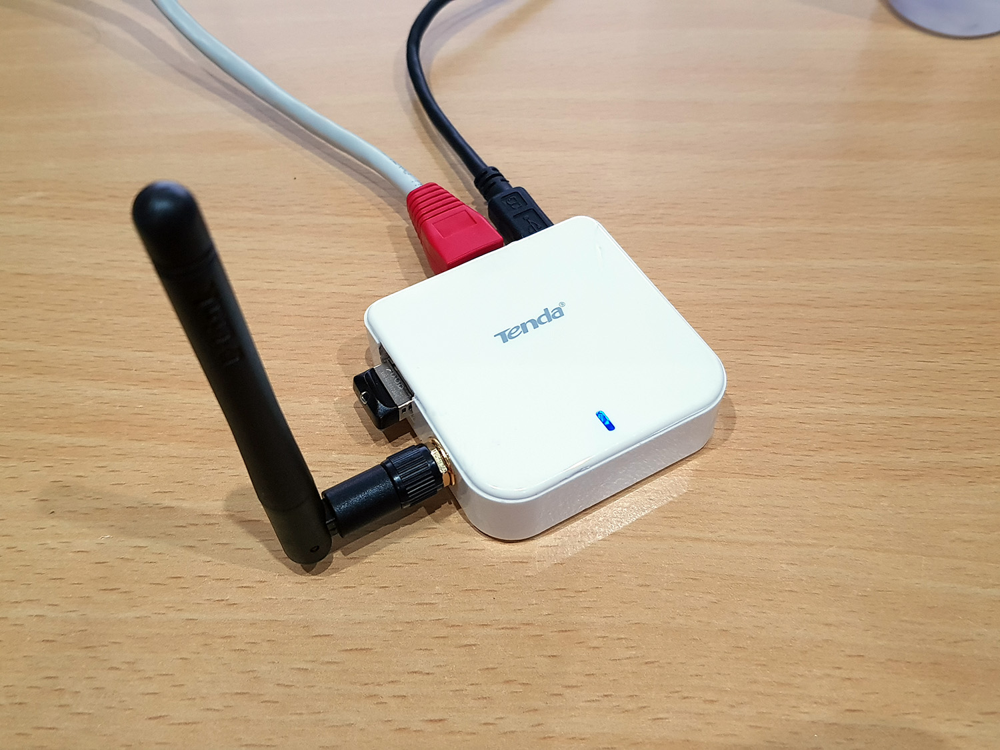
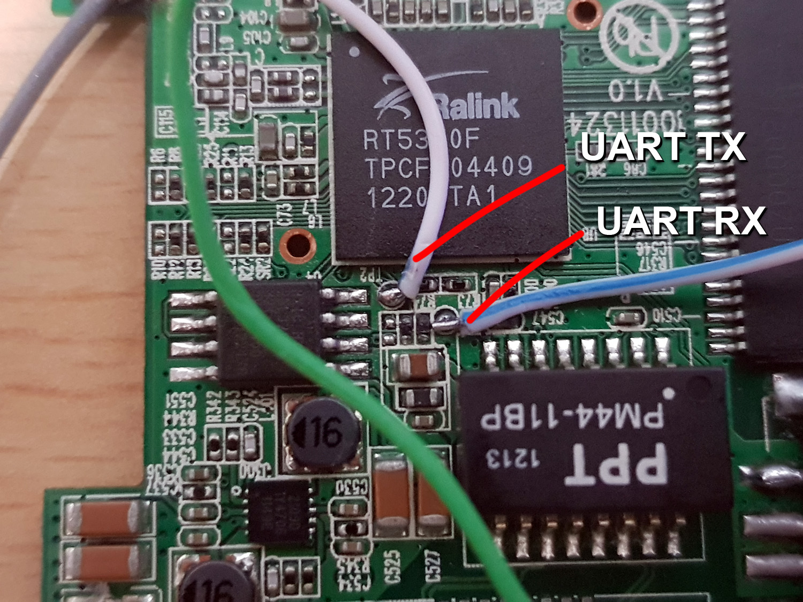
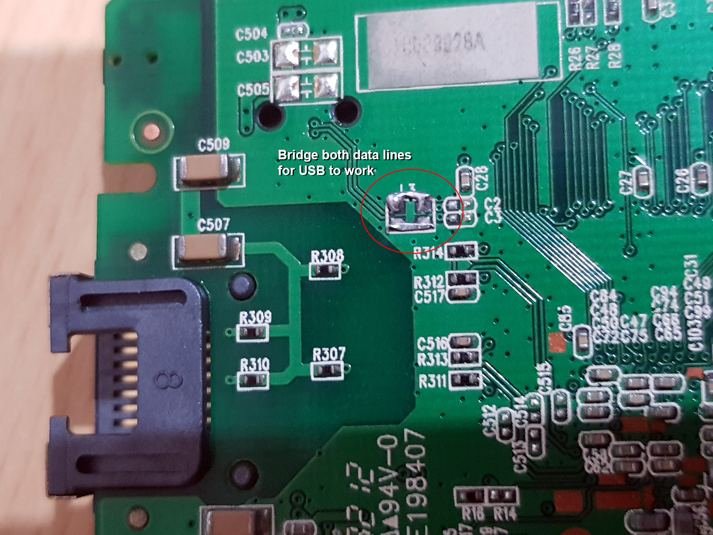
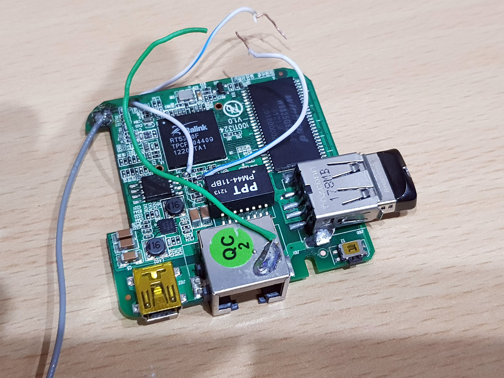

# OpenWrt-A6

***Preface:** I published a pull request for OpenWrt to officially support the Tenda A6 (https://github.com/openwrt/openwrt/pull/2988), but it was never merged. This repo keeps the A6 working on **OpenWrt 19.07.10** (the last 19.07 release) with the **official kernel binary**, so packages and kernel modules from the official OpenWrt feeds install as-is. The original 19.07.2 build is preserved on the [`legacy-19.07.2`](../../../tree/legacy-19.07.2/tenda-a6) branch.*

<a href="photos/tenda-a6_mod-complete.jpg"></a>
<a href="photos/tenda-a6_uart-pins.jpg"></a>
<a href="photos/tenda-a6_usb-enable.jpg"></a>
<a href="photos/tenda-a6_usb-populated.jpg" title="USB port added successfully!"></a>

This repo details the process to get OpenWrt up and running on a Tenda A6, a miniature but potentially feature-rich wireless router for the price. It is very similar to the unbranded A5-V11 (https://oldwiki.archive.openwrt.org/toh/unbranded/a5-v11), sharing the same SoC - Ralink/MediaTek RT5350F. It has 32MiB of RAM memory, and 4MiB of SPI flash storage.

There is already some information on the OpenWrt Wiki about this device (https://openwrt.org/toh/tenda/a6), although the patches and build instructions there are stale.

The included 4MiB of flash is very restrictive - LuCI does not fit in the flash image. The images here leave about 700KiB of writable space (`/overlay`), which is enough for configuration and a few small packages. If you need more, you can either replace the 4MiB flash chip with a larger one, or add external USB storage (extroot). Both require some soldering - if you can't solder then I would really suggest just keeping the factory firmware instead.

*Why 19.07.10 and not something newer? Newer releases still support this SoC, but they no longer fit in 4MiB. For example, on 25.12 the official kernel alone is ~2.0MiB, and the smallest usable Wi-Fi-client root filesystem is ~2.0MiB, which is more than the ~1.8MiB left over. With a bigger flash chip, a newer release is the way to go.*

Fortunately, the RT5350F SoC chip comes with USB support, and the A6 even has a 'hidden' (unpopulated) USB port header (see above images for details). It is not enough to just solder on a USB port or cable to the exposed headers - you must also bridge the D+ and D- filter paths at the back of the unit.

Access to the PCB can be optained by delidding the top of the enclosure, which involves *carefully* scoring around the edge with a sharp knife until it pops open. Mine popped open quite easily, but YMMV.

*You can optionally connect a UART USB/serial device (see https://iotnewsgenerator.wordpress.com/2016/03/27/tenda-a6-wifi-router/) in order to monitor device status which can be helpful for streamlining or debugging the TFTP process described below. Set baud rate for UART interface to 57600.*

### What's in here

| Path | What it is |
|---|---|
| `images/` | Ready-to-flash 19.07.10 images (official default package set), plus the official `*.buildinfo` and `sha256sums` |
| `flashdumps/flashdump-openwrt-19.07.10-ramips-rt305x-a6-squashfs.bin` | Full 4MiB SPI image (stock u-boot + factory with placeholder MAC + OpenWrt) |
| `flashdumps/flashdump-A6_V3.00.20_EN.bin` | Stock Tenda firmware, full 4MiB dump |
| `openwrt-19.07.10-tenda-a6.patch` | A6 support for the OpenWrt v19.07.10 source tree |
| `imagebuilder/` | Scripts that build the images with the official ImageBuilder and official kernel |
| `bootloader/uboot256.img` | Recovery u-boot (see Troubleshooting) |

The kernel in these images is the official 19.07.10 binary (`kernel 4.14.275-1-f898e190859a99de54f37f71337b8ec8`) with the A6 device tree appended, so `opkg install kmod-...` works straight from the official feeds.

### How-to: flash
#### Method 1 - Upgrade by factory firmware's Web UI
It is possible to upgrade from the factory-loaded firmware using the Web UI, but you must *not* upgrade directly to squashfs-sysupgrade image from factory firmware. Rather, you will need to use the initramfs image, or you will brick your device! *You have been warned.*

**Step 1:** Download temporary initramfs bin <a href="https://raw.githubusercontent.com/fragtion/openwrt-hardware/master/tenda-a6/images/openwrt-19.07.10-ramips-rt305x-a6-initramfs-kernel.bin">openwrt-19.07.10-ramips-rt305x-a6-initramfs-kernel.bin</a>, and the full image <a href="https://raw.githubusercontent.com/fragtion/openwrt-hardware/master/tenda-a6/images/openwrt-19.07.10-ramips-rt305x-a6-squashfs-sysupgrade.bin">openwrt-19.07.10-ramips-rt305x-a6-squashfs-sysupgrade.bin</a> to your computer.

**Step 2:** Flash the initramfs bin from the factory firmware's web UI's firmware upgrade interface. The router will reboot as indicated by the web UI. Allow sufficient time for the reboot and upgrade to complete. OpenWrt takes longer to boot than the factory-supplied firmware, so be patient.

**Step 3:** During this time, you can set your computer's IP address to 192.168.1.2. After a few minutes, you should be able to ping the router at 192.168.1.1.

**Step 4:** Copy the full image to the router (the router has no HTTPS support, so copying from your computer is easiest):

```
scp openwrt-19.07.10-ramips-rt305x-a6-squashfs-sysupgrade.bin root@192.168.1.1:/tmp/
```

**Step 5:** SSH to the router at 192.168.1.1 (username root, no password - don't set one yet, you're still on a temporary RAM image) and flash:

```
sysupgrade -n /tmp/openwrt-19.07.10-ramips-rt305x-a6-squashfs-sysupgrade.bin
```

The device will self-reboot, and will take a few minutes before you can ping 192.168.1.1 again. Be patient...

You can then log in via SSH as root, with no password. At this point you should change the root password (`passwd`).

**Step 6:** Done! You're now ready to go to Post-flashing

*There is also a `squashfs-factory.bin` image (Poray header, A5-V11 hardware ID/key, which the A6 shares). It has not been tested from the stock web UI - the initramfs route above is the tested one.*

#### Method 2 - Upgrade via SPI Programmer (Full image flash)
**Step 1:** Ensure that the device is not powered by USB

**Step 2:** Download <a href="https://github.com/fragtion/openwrt-hardware/blob/master/tenda-a6/flashdumps/flashdump-openwrt-19.07.10-ramips-rt305x-a6-squashfs.bin?raw=true">flashdump-openwrt-19.07.10-ramips-rt305x-a6-squashfs.bin</a>. It contains the placeholder MAC `C8:3A:35:00:00:A6` - set the MAC from the sticker under your device the same way as described under *Restoring Tenda A6's factory firmware* below (same offset).

*Better still: if you already dumped your own chip, keep your own first 0x50000 bytes (u-boot, u-boot-env and factory - the factory partition also holds your Wi-Fi calibration data) and only take the rest from this file, e.g. `dd if=flashdump-openwrt-19.07.10-ramips-rt305x-a6-squashfs.bin of=mydump.bin bs=64k skip=5 seek=5 conv=notrunc`.*

**Step 3:** Write it to the flash chip using an SPI programmer of choice

**Step 4:** Verify flashed image if programmer supports it

**Step 5:** Done! Boot it up and you're ready to go to Post-flashing.

#### Method 3 - Upgrade by SPI Programmer (TFTP image from new uboot)
**Step 1:** Ensure that the device is not powered by USB

~**Step 2:** Flash OpenWrt-compatible uboot <a href="https://raw.githubusercontent.com/fragtion/openwrt-hardware/master/tenda-a6/bootloader/uboot256.img">uboot256.img</a> using using SPI programmer of choice~ _actually, this seems to break wifi mac - use it only for troubleshooting_

**Step 3:** Verify flashed image if programmer supports it

**Step 4:** Power on the device while holding reset button, and proceed to TFTP the squashfs-sysupgrade image (see Troubleshooting section below for TFTP instructions)

**Step 5:** Done! Boot it up and you're ready to go to Post-flashing

#### Upgrading an existing OpenWrt install
From any OpenWrt already running on the A6 (board name `a6`), copy the sysupgrade image to `/tmp` and run `sysupgrade -n /tmp/openwrt-19.07.10-ramips-rt305x-a6-squashfs-sysupgrade.bin`. Two lessons learned:

* If you run from a USB extroot, boot without it first (remove the stick, or disable the `/overlay` mount in `/etc/config/fstab` and reboot). Pulling the extroot from under a running system makes it reboot without flashing.
* Start sysupgrade detached from your SSH session, so a dropped connection can't kill it: `start-stop-daemon -S -b -x /bin/sh -- -c "sleep 3; sysupgrade -n /tmp/fw.bin"`

### Post-flashing
The official package feeds are preconfigured, and because the kernel is the official one, kernel modules install normally:

```
opkg update
opkg install kmod-usb-serial-pl2303    # for example
```

Keep an eye on free space (`df -h /overlay`) - there are roughly 700KiB to play with.

#### Optional: USB extroot (more space, LuCI)
If you soldered on a USB port, you can use a USB drive to extend the limited onboard storage. Follow the official guide at https://openwrt.org/docs/guide-user/additional-software/extroot_configuration, or my method below.

First, using a partitioning tool of your choice (eg, minitool partition wizard for windows, or gparted for linux), prepare the USB storage into 3 partitions as follows:

```
Partition 1: primary, ext4, boot/active (for extending /overlay/)
Partition 2: primary, swap (for swap obviously)
Partition 3: primary, ext4 (for custom /data/ mountpoint)
```

*Size ratios are up to you. I used a 8GB flash drive, with 3GB for /overlay, 1GB for swap, and 4GB for /data)*

Install the storage support (this fits in the onboard space):

```
opkg update
opkg install block-mount kmod-usb-storage kmod-fs-ext4
```

Plug in the USB drive and ensure that it is detected by your A6 (`dmesg`, or `ls /dev/sda` will work)...

Assuming your USB device was found, now execute the following:

```
mkdir -p /underlay
mkdir -p /data
mount /dev/sda1 /mnt
tar -C /overlay/ -cvf - . | tar -C /mnt/ -xf -
rm -f /mnt/etc/.extroot-uuid
```

Now edit fstab `vi /etc/config/fstab` *(note: this file is not the same as `/etc/fstab`, which shouldn't be touched)*, as follows:

```
config global
        option anon_swap '0'
        option anon_mount '1'
        option auto_swap '1'
        option auto_mount '1'
        option delay_root '5'
        option check_fs '0'

config mount
        option target '/underlay'
        option device '/dev/mtdblock6'
        option enabled '1'

config mount
        option target '/overlay'
        option device '/dev/sda1'
        option enabled '1'

config swap
        option device '/dev/sda2'
        option enabled '1'

config mount
        option target '/data'
        option device '/dev/sda3'
        option enabled '1'
```

Commit and apply the changes to `/etc/config/fstab` by executing `uci commit && service fstab enable`

Now `reboot` the router. When you log in again you should see that the space has grown when you use the `df` command and /overlay is mounted as `/dev/sda1` when you use the `mount` command.

You can now install LuCI to your (much bigger!) extroot space: `opkg update && opkg install luci`

### How-to: build
#### Option A - official ImageBuilder (recommended, this is how `images/` was built)
On a Linux x86_64 host with the [ImageBuilder prerequisites](https://openwrt.org/docs/guide-user/additional-software/imagebuilder#prerequisites):

```
git clone https://github.com/fragtion/openwrt-hardware.git
cd openwrt-hardware/tenda-a6
./imagebuilder/build.sh /path/to/workdir
```

`build.sh` downloads and checksum-verifies the official 19.07.10 ImageBuilder and SDK, applies `openwrt-19.07.10-tenda-a6.patch` to a v19.07.10 source checkout, mirrors it into the ImageBuilder, then builds `a6-kernel.bin` and the initramfs from the **official** `vmlinux` plus the A6 device tree. Before building the A6 kernel it checks that the very same recipe reproduces the official A5-V11 kernel and the official 3G150B initramfs byte-for-byte, so the result is exactly what the OpenWrt buildbot would produce for an A6 profile.

Customize the package set the usual ImageBuilder way, e.g.:

```
PACKAGES="-ppp -ppp-mod-pppoe -odhcp6c -odhcpd-ipv6only kmod-usb-serial-pl2303" ./imagebuilder/build.sh /path/to/workdir
```

and add your own files with `FILES=/path/to/overlay`. `imagebuilder/mkflashdump.sh` builds the full SPI image.

#### Option B - from source
```
git clone -b v19.07.10 https://github.com/openwrt/openwrt.git
cd openwrt
git apply /path/to/openwrt-19.07.10-tenda-a6.patch
./scripts/feeds update -a && ./scripts/feeds install -a
make menuconfig    # Target: Ralink RT288x/RT3xxx > RT3x5x/RT5350 > Tenda A6
make -j$(nproc)
```

Note that a source build produces its own kernel, whose hash will differ from the official one, so official kmods will refuse to install (`Cannot satisfy the following dependencies for kmod-...: kernel (= ...)`). Build the modules you need from source too, or use Option A.

### Important notes
If you need to use the UART serial interface, bear in mind that it will only allow input/choice selection one time only, after which the SoC then blocks all future input. If something goes wrong after that and you can't boot, there should be no need to panic (or worse, throw away some perfectly good hardware!), as the device can be de-bricked with the right tools. You will just need to re-flash the bootloader and then TFTP. See Troubleshooting section below.

### Troubleshooting
If you think you bricked the device, you can probably still recover using a CH341A or similar SPI programmer (Raspberry PI can work too). Supplied bootloader image file <a href="https://raw.githubusercontent.com/fragtion/openwrt-hardware/master/tenda-a6/bootloader/uboot256.img">uboot256.img</a> was found at repository https://github.com/ozayturay/OpenWrt-A5-V11/

After flashing the uboot with SPI programmer, power-cycle the device while holding down the reset button, and upload new image via TFTP:

`tftp -i 192.168.1.1 PUT openwrt-19.07.10-ramips-rt305x-a6-squashfs-sysupgrade.bin`

*Please note that the device will not respond to pings during the uboot/tftp process. But if you do everything right, you should see a TFTP success message, and then wait about 5-10 minutes for flashing, after which you can ping and SSH to 192.168.1.1*

No need to reboot after tftp as it will do so automatically. Give it time (5-10 minutes) to boot to OpenWrt and initialize ethernet (patience is key)

### Restoring Tenda A6's factory firmware (A6_V3.00.20_EN.bin)
If you decide that OpenWrt is not for you, here's how you can get your router back to its factory-fresh state

**Step 1:** Download <a href="https://github.com/fragtion/openwrt-hardware/blob/master/tenda-a6/flashdumps/flashdump-A6_V3.00.20_EN.bin?raw=true">flashdump-A6_V3.00.20_EN.bin</a>, and set MAC address according to sticker under your device

For example, if you want to set MAC to `C8:3A:35:00:00:A6`:

`printf '\xC8\x3A\x35\x00\x00\xA6' | dd of=flashdump-A6_V3.00.20_EN.bin bs=1 seek=262148 count=6 conv=notrunc`

**Step 2:** Ensure that the device is not powered by USB

**Step 3:** Write `flashdump-A6_V3.00.20_EN.bin` to flash chip using using SPI programmer of choice

**Step 4:** Verify flashed image if programmer supports it

**Step 5:** Done!

### Disclaimer
Anything you do to your own router is your own responsibility. I am not responsibile for your actions and/or any damages or losses that may result, such as a bricked router. These methods worked for me, I offer no guarantees that the same will be true for you. Proceed at your own risk. If you do, then Good luck! :)

### Donate
Did this make you happy? I'd love to do more development like this! Please donate to show your support :)

BTC: 1Q4QkBn2Rx4hxFBgHEwRJXYHJjtfusnYfy

XMR: 4AfeGxGR4JqDxwVGWPTZHtX5QnQ3dTzwzMWLBFvysa6FTpTbz8Juqs25XuysVfowQoSYGdMESqnvrEQ969nR9Q7mEgpA5Zm
